 

 

  

 

### Selected work

Products I designed, built and deployed. Each card opens the live site or demo.

  
  
  
  

 

### Technical expertise

  

 

### GitHub activity

  

 

### Let's work together

I'm open to freelance projects and full-time roles, remote or in Morocco. You can write to me in Darija, French or English.

  <a href="https://el-hossaine-ahabchane.vercel.app/"><b>Portfolio</b></a> &nbsp;·&nbsp;
  <a href="https://www.linkedin.com/in/elhoussaine-ahabchane/"><b>LinkedIn</b></a> &nbsp;·&nbsp;
  <a href="https://github.com/houssa-dev"><b>GitHub</b></a>

Artwork is generated from <code>config.json</code> by <code>scripts/generate.py</code>; the activity panel is a dated snapshot of GitHub contribution data.
