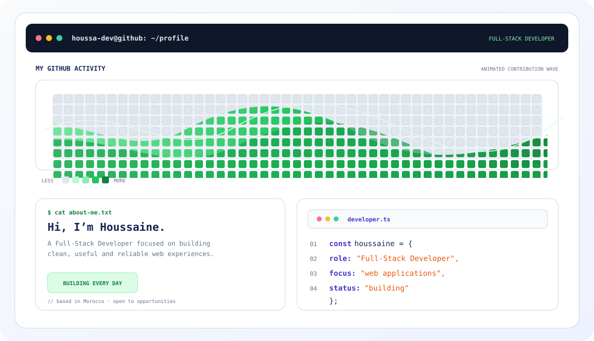

<div align="center">


<br/>

<a href="https://github.com/houssa-dev">

</a>

<br/><br/>



<br/>

[](https://github.com/houssa-dev)
[](https://www.linkedin.com/in/houssa-dev/)

</div>

<div align="center">


</div>

<br/>

## 00 · Field Notes

<table align="center">
<tr>
<td>

```
LOG  2026-09   Rebuilding React fundamentals via FreelanceHub — real bugs, real fixes.
LOG  2026-08   Shipping API-first services with Hono + Zod. Small. Typed. Composable.
LOG  2026-07   Thinking in event-driven, microservice patterns for AI platforms.
LOG  ongoing   Refining Haverion Tech — code and brand, same care, same standard.
```

</td>
</tr>
</table>

<br/>

## 01 · Stack

<div align="center">


</div>

<br/>

```
principle(01) → understand before you code
principle(02) → modular > monolithic
principle(03) → API-first, always
principle(04) → typed everything
principle(05) → clean architecture is a habit, not a phase
```

<br/>

## 02 · System Map

<div align="center">

</div>

<br/>

## 03 · The Numbers

<div align="center">


<br/>

</div>

<br/>

## 04 · Mission Control

<div align="center">


</div>

<br/>

## 05 · Outside the Editor

<div align="center">

| ⚽ | 🎨 | 🗣️ | 📍 |
|:---:|:---:|:---:|:---:|
| Atlas Lions, always | Haverion Tech branding | Darija · Français · English | Khénifra, Morocco |

</div>

<br/>

---

<div align="center">


**[github.com/houssa-dev](https://github.com/houssa-dev)** — always building something.

</div>
